# Mobile Architecture

This document describes Craft's mobile platform architecture for iOS and Android.

## Overview

Craft provides a unified mobile API through `mobile.zig` that abstracts iOS and Android platform differences while exposing platform-specific features when needed.

## Platform Abstraction

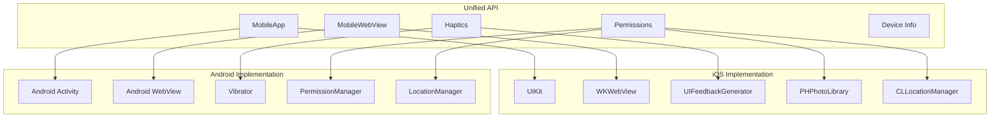

## iOS Architecture

### Application Lifecycle

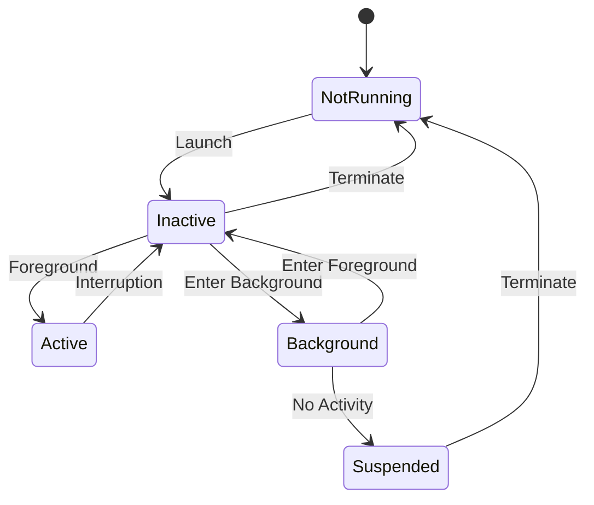

### WKWebView Integration

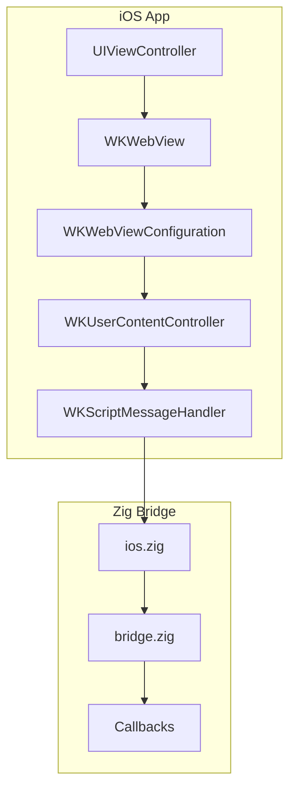

### iOS-Specific Features

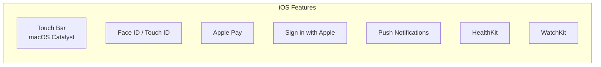

## Android Architecture

### Activity Lifecycle

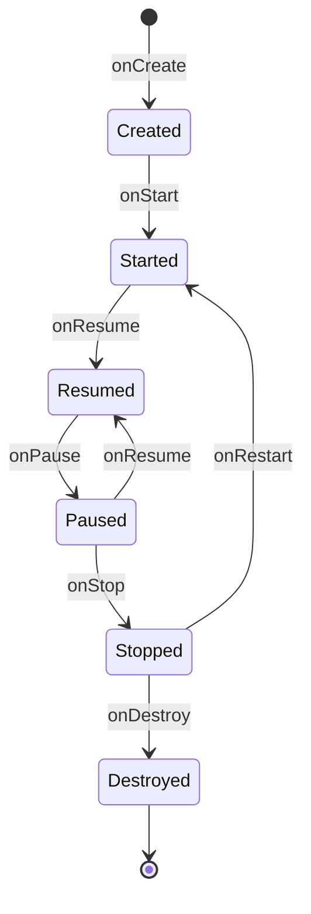

### WebView Integration

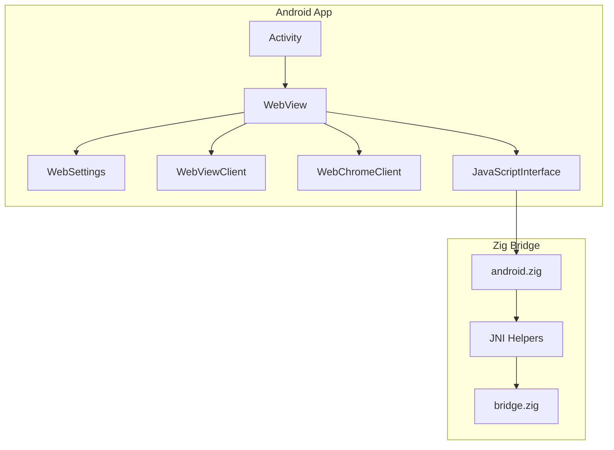

### Android-Specific Features

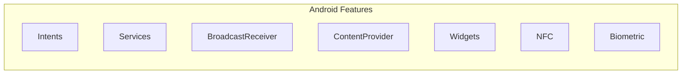

## Permission System

### iOS Permissions

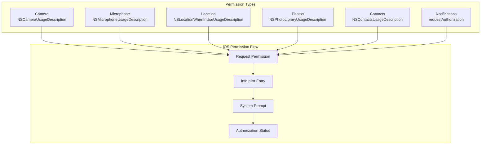

### Android Permissions

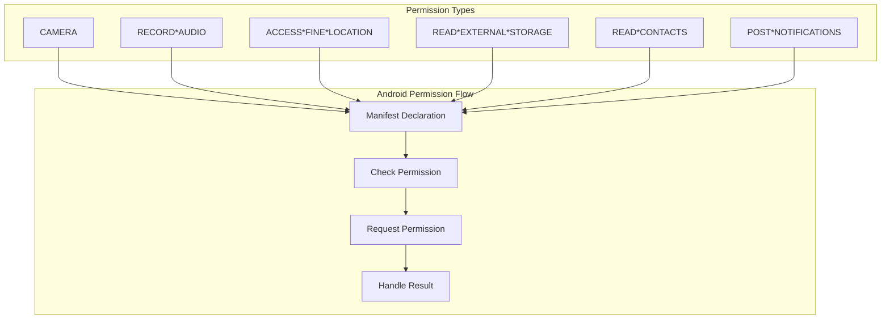

## Unified Permission API

```zig
pub const Permission = enum {
    camera,
    microphone,
    location,
    location*always,
    photos,
    contacts,
    notifications,
    calendar,
    reminders,
    bluetooth,
};

pub const PermissionStatus = enum {
    not*determined,
    restricted,
    denied,
    authorized,
    limited,
};

pub fn requestPermission(permission: Permission) !PermissionStatus {
    // Platform-specific implementation
}
```

## Haptic Feedback

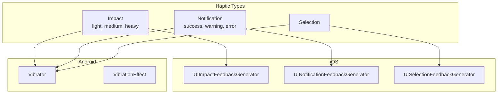

## Bridge Protocol (Mobile)

### iOS Message Handler

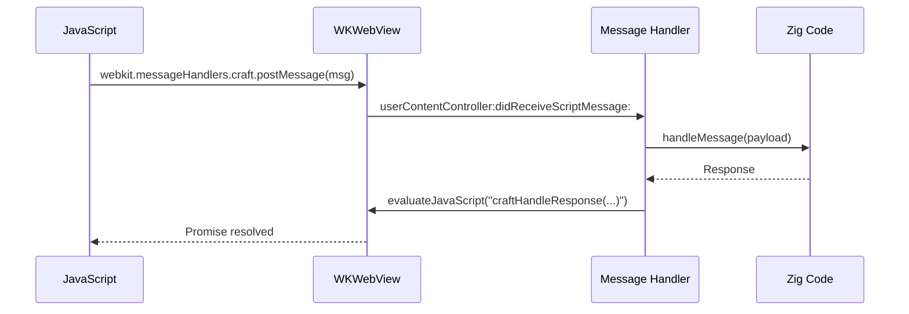

### Android JavaScript Interface

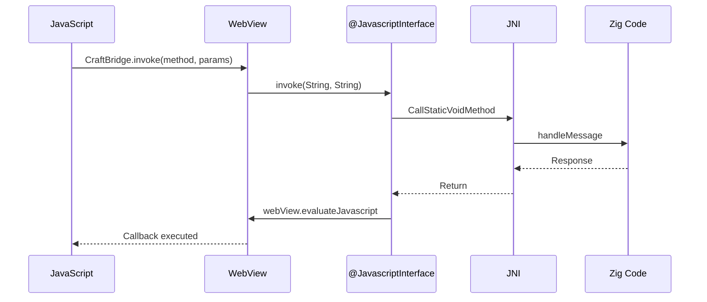

## Native Object Management

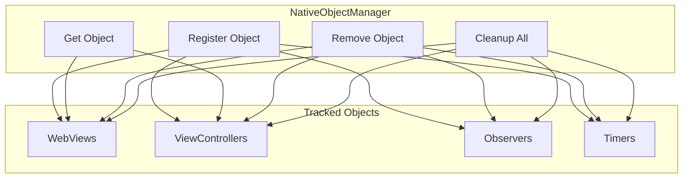

## Build Configuration

### iOS Targets

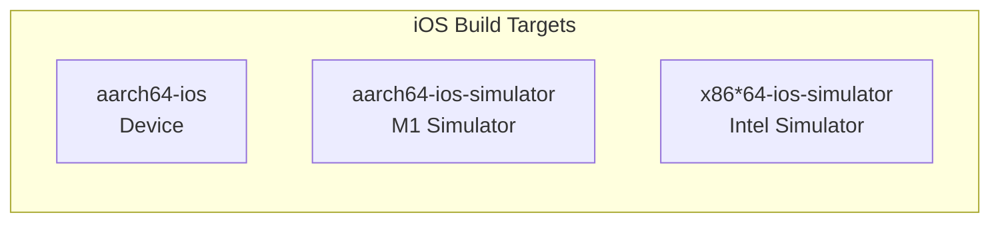

### Android Targets

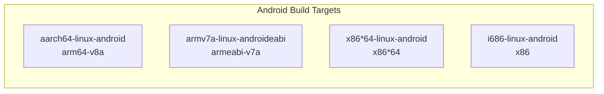

## Project Templates

### iOS Template Structure

```
MyApp/
├── MyApp.xcodeproj/
├── MyApp/
│   ├── AppDelegate.swift
│   ├── SceneDelegate.swift
│   ├── ViewController.swift
│   ├── Info.plist
│   └── Assets.xcassets/
├── Frameworks/
│   └── libcraft.a
└── web/
    └── index.html
```

### Android Template Structure

```
MyApp/
├── app/
│   ├── build.gradle
│   ├── src/main/
│   │   ├── java/com/myapp/
│   │   │   └── MainActivity.java
│   │   ├── jniLibs/
│   │   │   ├── arm64-v8a/
│   │   │   └── x86*64/
│   │   ├── res/
│   │   └── AndroidManifest.xml
│   └── src/main/assets/
│       └── web/
│           └── index.html
├── build.gradle
└── settings.gradle
```

## Further Reading

- [mobile.zig](../../packages/zig/src/mobile.zig) - Mobile implementation
- [PLATFORM*SUPPORT.md](../../packages/zig/PLATFORM*SUPPORT.md) - Platform feature matrix
- [ios*template.zig](../../packages/zig/src/ios*template.zig) - iOS project template
- [android*template.zig](../../packages/zig/src/android_template.zig) - Android project template

## Package-owned native shells

Applications author TypeScript and STX. Craft publishes its Swift shell templates
inside `craft-native` (`dist/ios/templates`) and `@craft-native/ios` (`templates`).
The iOS builder generates sources from typed `CraftConfig`; generated Swift is
build output, including the optional watch and live activity extensions.
Configure capabilities, appearance, tabs, storage sharing, privacy and deployment
targets through TypeScript. Add reusable native capabilities to Craft and expose
typed bridge methods instead of patching an application's generated Swift.

An Xcode Cloud application may retain its Xcode project, configuration, assets
and compiled STX bundle in Git for project discovery, while ignoring `*.swift`.
After installing the locked dependencies, its `ci_scripts/ci_post_clone.sh` can
restore sources without regenerating the project or compiling application screens:

```ts
import { restoreShell } from 'craft-native/ios'
restoreShell('storage/framework/mobile/ios')
```

`restoreShell` uses the project's `craft.config.json` and the installed package's
templates. Keep that configuration, Xcode metadata and package lockfile from the
same build; rebuild the complete project after changing capabilities or upgrading
Craft. Restoration replaces generated Swift; application edits there do not persist.

To make the zero-Swift rule enforceable in an app's own checks, use the source audit
from the same package. It ignores dependency/build output and the standard Stacks
generated tree, but fails on any Swift the application owns:

```ts
import { assertNoApplicationSwiftSources } from 'craft-native/ios'

assertNoApplicationSwiftSources(process.cwd())
```

Projects that keep generated iOS output somewhere else can pass that path through
`ignoredPaths`. The audit returns relative paths from `findApplicationSwiftSources`
when a CI job needs to report them instead of throwing.

## Simulator tests from TypeScript

The Bun-only `craft-native/ios` entrypoint also exports the reusable XCUITest host:

```ts
import { initSimulatorDriver, serializeSimulatorSteps } from 'craft-native/ios'

initSimulatorDriver({
  output: 'storage/framework/mobile/ios-driver',
  bundleId: 'org.example.app',
  tabs: ['Today', 'Calendar'],
  controlUrl: 'http://127.0.0.1:3401',
})
const script = serializeSimulatorSteps([
  { command: 'launch' },
  { command: 'expect', text: 'Today', seconds: 10 },
  { command: 'net', state: 'offline' },
  { command: 'tab', text: 'Calendar' },
])
```

Generate its Xcode project with xcodegen, then `xcodebuild build-for-testing` and
`test-without-building` on an iOS 17+ simulator. Serve `script` at `/script` on the
control URL. The driver posts `/note` and `/save?name=…` evidence and supports the
existing line-based journey protocol; network and hook steps require the control
server to implement those endpoints. Override the control URL per run through
`TEST_RUNNER_CRAFT_TEST_CONTROL`. Failed checks fail XCTest while allowing the
remaining journey to collect evidence. This harness drives an already installed
app; it does not install the app or operate a network switch itself.

`createNativeMutationValidator()` compiles Craft's actual Foundation mutation
host with `swiftc` on macOS. Its `validate(messages)` returns `exitCode`, `stdout`
and `stderr`; call `dispose()` when finished. This checks native update batches,
not UIKit layout or device capability behavior. These build/test APIs are Bun-only;
browser code continues to import `craft-native/mobile`.
